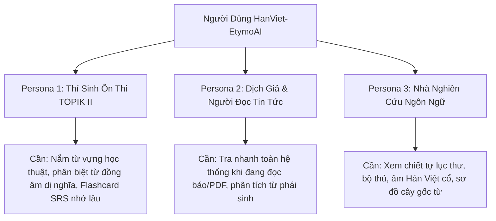
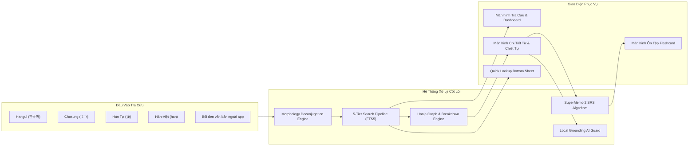
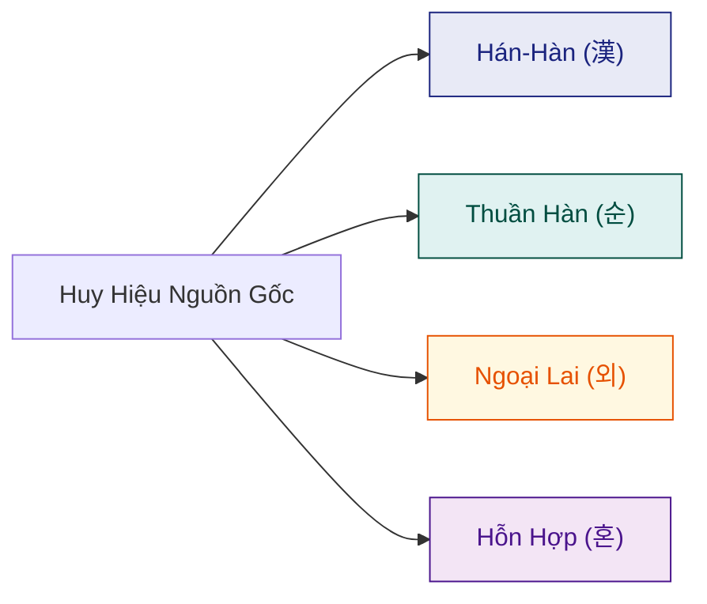

# 🎨 BẢN THIẾT KẾ TOÀN DIỆN ỨNG DỤNG HANVIET-ETYMOAI (DESIGN.MD)
> **Dự án**: HanViet-EtymoAI (Từ Điển Từ Nguyên Hán-Hàn-Việt & Trợ Lý Học Tập AI Offline-First)  
> **Nền tảng**: Android 8.0+ (API Level 26+)  
> **Công nghệ giao diện**: Jetpack Compose, Material Design 3, Kotlin Coroutines & Flow  
> **Phiên bản tài liệu**: 2.2.0 (Tháng 10/2026)  

---

## 1. TỔNG QUAN SẢN PHẨM & TẦM NHÌN THIẾT KẾ

### 1.1 Tôn chỉ thiết kế (Design Philosophy)
HanViet-EtymoAI được xây dựng xoay quanh 4 trụ cột cốt lõi:
1. **Học Thuật Chuẩn Xác (Academic Rigor)**: Không bao giờ suy đoán hay "bịa" nguồn gốc từ. Dữ liệu từ nguyên được phân tầng minh bạch giữa Từ điển Chuẩn Quốc gia (NIKL, StarDict, Viện Hán Nôm) và diễn giải của AI.
2. **Tốc Độ Tức Thì (Instant Feedback)**: Mọi thao tác gõ phím, tra cứu đều phản hồi trong thời gian **dưới 50ms** nhờ kiến trúc 5 tầng tìm kiếm và SQLite FTS5 tối ưu hóa cục bộ.
3. **Offline-First & Bảo Mật Tuyệt Đối (Zero Permissions)**: Hoạt động trọn vẹn 100% không cần kết nối mạng. Không yêu cầu các quyền nguy hiểm (vị trí, danh bạ, vẽ đè màn hình).
4. **Trực Quan Hóa Tri Thức (Knowledge Visualization)**: Biến các ký tự chữ Hán trừu tượng và các hình thức biến đổi ngữ pháp phức tạp thành cây đồ thị trực quan, dễ nhớ, dễ hiểu.

### 1.2 Cầu nối ngôn ngữ độc đáo
Khoảng **70% vốn từ vựng tiếng Hàn là từ Hán-Hàn (한자어 - Hanja-eo)**, chia sẻ chung hệ thống gốc từ ngữ nghĩa với từ **Hán-Việt**. 
Ví dụ:
- **학생 (Hak-saeng)** ➔ **學生** (Hán Tự) ➔ **Học sinh** (Hán-Việt)
- **학교 (Hak-gyo)** ➔ **學校** (Hán Tự) ➔ **Học hiệu / Trường học** (Hán-Việt)
- **학습 (Hak-seup)** ➔ **學習** (Hán Tự) ➔ **Học tập** (Hán-Việt)

HanViet-EtymoAI tận dụng chính mối tương đồng văn hóa - ngôn ngữ này để tạo ra một "đường tắt thần kinh" (neural shortcut) giúp người Việt nắm bắt hàng chục ngàn từ vựng tiếng Hàn nhanh gấp nhiều lần so với cách học vẹt thông thường.

### 1.3 Chân dung người dùng (User Personas)


---

## 2. THIẾT KẾ CÁC CHỨC NĂNG HỆ THỐNG (FUNCTIONAL SPECIFICATIONS)



### 2.1 Hệ Thống Tra Cứu Đa Chiều 5 Tầng (5-Tier Search Pipeline)
Ứng dụng cho phép tra cứu linh hoạt không cần chuyển đổi bàn phím liên tục:
- **Tầng 1 - Exact Match**: Khớp chính xác từ nguyên thể Hangul (`학교`).
- **Tầng 2 - Chosung Search (초성 검색)**: Tìm nhanh bằng phụ âm đầu tiếng Hàn (ví dụ: gõ `ㅎㄱ` sẽ tìm ra `한국`, `학교`, `한글`).
- **Tầng 3 - Hanja Direct Match**: Tra cứu trực tiếp bằng chữ Hán (ví dụ: gõ `學` hiển thị tất cả các từ có chứa chữ Học).
- **Tầng 4 - Sino-Vietnamese Match**: Tìm từ tiếng Hàn qua âm Hán-Việt không dấu hoặc có dấu (ví dụ: gõ `hoc` hoặc `học` hiển thị danh sách từ gốc `학 - 學`).
- **Tầng 5 - FTS5 Full-Text Search**: Tìm kiếm toàn văn trong phần giải nghĩa tiếng Việt, ví dụ minh họa và ngữ cảnh.

### 2.2 Bộ Phân Tích Biến Hình Từ Vựng (Morphology Deconjugation Engine)
Khi người dùng gặp một động từ/tính từ đã bị biến đổi ngữ pháp trong câu văn (ví dụ: `추웠어요`, `만드니까`, `갈수록`, `먹어서`), họ không thể tra được trong các từ điển thông thường nếu không biết dạng nguyên thể.
- **Tính năng**: Phân tích ngược cấu trúc tiếp vĩ ngữ (Suffix Stripping) và áp dụng quy tắc đảo ngược của **8 nhóm bất quy tắc tiếng Hàn**:
  1. Bất quy tắc ㄷ (`듣다` ➔ `들어요`)
  2. Bất quy tắc ㅂ (`춥다` ➔ `추워`)
  3. Bất quy tắc ㅅ (`짓다` ➔ `지어`)
  4. Bất quy tắc ㅡ (`크다` ➔ `커`)
  5. Bất quy tắc 르 (`모르다` ➔ `몰라`)
  6. Bất quy tắc ㅎ (`빨갛다` ➔ `빨개`)
  7. Bất quy tắc 여/러/우 (`하다` ➔ `하여/해`, `푸르다` ➔ `푸르러`)
- **Hiển thị trực quan**: Xuất hiện một thẻ badge "Dạng nguyên thể: **듣다** (Nghe) · Ngữ pháp: `-었/았-` + `-어요`".

### 2.3 Mô-đun Chiết Tự & Đồ Thị Từ Nguyên (Hanja Graph & Decomposition)
- **Phân rã âm tiết (Syllable Breakdown)**: Mỗi từ Hán-Hàn nhiều âm tiết được bóc tách thành các khối trực quan.
  - Ví dụ với từ **경제 (Kinh tế)**:
    - Khối 1: **경 (Kinh)** ➔ Chữ Hán: **經** (Kinh độ, đường dọc, kinh qua, kinh điển) · Bộ thủ: **糸** (Mịch - sợi chỉ) · 14 nét.
    - Khối 2: **제 (Tế)** ➔ Chữ Hán: **濟** (Cứu giúp, tế thế, qua sông) · Bộ thủ: **氵** (Thủy - nước) · 17 nét.
    - **Nghĩa cấu thành**: "Kinh bang tế thế" (经邦济世 - Trị nước cứu đời) ➔ Tinh thần của thuật ngữ kinh tế học phương Đông.
- **Cây họ từ vựng (Word Family Graph)**:
  - Cho phép người dùng chạm vào bất kỳ chữ Hán nào để mở rộng danh sách các từ phái sinh khác có chứa chữ Hán đó.
- **Hệ thống Huy hiệu Phân loại Nguồn gốc (Origin Badges)**:
  - `SINO_KOREAN` (Hán-Hàn): Màu chàm (Indigo), biểu tượng chữ **漢**.
  - `NATIVE_KOREAN` (Thuần Hàn): Màu xanh mòng két (Teal), biểu tượng chữ **순**.
  - `LOANWORD` (Từ ngoại lai): Màu hổ phách (Amber), biểu tượng chữ **외**.
  - `MIXED` (Từ hỗn hợp): Màu tím hoa cà (Purple), biểu tượng chữ **혼**.

### 2.4 Không Gian Cá Nhân & Thuật Toán Lặp Lại Ngắt Quãng (Workspace & SRS SM-2)
- **Lưu trữ độc lập**: Sử dụng kiến trúc Dual-Database; từ vựng lưu trữ cá nhân nằm trong `user_workspace.db` (Room Database), hoàn toàn độc lập với kho từ điển cốt lõi `dictionary_core.db`.
- **Thuật toán SuperMemo 2 (SM-2)**:
  - Tự động tính toán các chỉ số: Hệ số dễ (`Ease Factor`, mặc định 2.5), Khoảng cách ôn tập (`Interval`, ngày), Số lần lặp lại (`Repetitions`).
  - Đánh giá phản hồi 5 mức:
    - **Grade 1 (Blackout)**: Quên hoàn toàn ➔ Reset chu kỳ về ngày 1.
    - **Grade 2 (Incorrect)**: Nhớ sai lệch ➔ Luyện lại ngay trong ngày.
    - **Grade 3 (Hard)**: Nhớ được nhưng rất khó khăn ➔ Giảm Ease Factor.
    - **Grade 4 (Good)**: Nhớ chuẩn xác sau một chút đắn đo ➔ Tăng khoảng cách hợp lý.
    - **Grade 5 (Easy)**: Nhớ ngay tức thì và thấu suốt ➔ Tăng tối đa khoảng cách ôn tập.
- **Chế độ Thẻ Lật 3D (3D Flip Flashcard)**: Mặt trước hiển thị Hangul + phát âm; Chạm để lật ra mặt sau hiển thị Chữ Hán, Âm Hán Việt, Nghĩa, Chiết tự và Câu ví dụ.

### 2.5 Tra Cứu Toàn Hệ Thống Không Cần Mở App (System-wide Quick Lookup)
- Tích hợp chuẩn Android `ACTION_PROCESS_TEXT`:
  - Khi người dùng bôi đen văn bản tiếng Hàn trong trình duyệt Chrome, ứng dụng đọc sách, KakaoTalk hay phụ đề YouTube, mục **"Tra Hán-Việt"** sẽ xuất hiện ngay trên thanh công cụ chọn văn bản (Text Selection Toolbar).
- **Giao diện Quick Lookup Bottom Sheet**:
  - Trượt nhẹ từ đáy màn hình lên, chiếm 45% diện tích.
  - Hiển thị ngay từ loại, phát âm, chữ Hán, nghĩa Hán-Việt và bản dịch nhanh.
  - Tích hợp nút **1 chạm lưu vào Flashcard SRS** (`+ Thêm thẻ`).
  - Nút **Mở toàn màn hình** nếu người dùng muốn nghiên cứu chiết tự chuyên sâu.

### 2.6 Tầng Trí Tuệ Nhân Tạo Có Kiểm Soát (Grounded AI & BYOK)
- **Bring Your Own Key (BYOK)**: Cho phép người dùng nhập khóa API cá nhân của Google Gemini, OpenAI, Claude hoặc DeepSeek để giải thích ngữ cảnh nâng cao.
- **Local Grounding Guard**:
  - Thuật toán bảo vệ chống "ảo giác" (Hallucination): Trước khi gửi prompt đến AI, hệ thống cục bộ tự động trích xuất các mục từ từ điển đã chứng thực (`dictionary_core.db`) làm "tài liệu minh chứng" (Grounding Context).
  - Yêu cầu AI chỉ được giải thích ngữ pháp và ví dụ thực tế dựa trên các gốc từ đã được minh chứng; cấm suy đoán bậy bạ nguồn gốc chữ Hán.
- **Cấp độ chứng thực minh bạch**:
  - `VERIFIED_PRIMARY`: Đã đối soát chuẩn xác với Viện Ngôn Ngữ Hàn Quốc (NIKL).
  - `COMMUNITY_VERIFIED`: Dữ liệu cộng đồng kiểm duyệt.
  - `AI_GROUNDED`: Diễn giải từ AI có đính kèm bằng chứng tra cứu.

---

## 3. THIẾT KẾ TRẢI NGHIỆM NGƯỜI DÙNG (UX DESIGN)

### 3.1 Các Luồng Trải Nghiệm Chính (Primary User Flows)

#### User Flow 1: Tra cứu tức thì từ ứng dụng ngoài (Cross-app Flow)
```
[Ứng dụng bất kỳ: Web/PDF/Chat]
       │ (Bôi đen từ vựng tiếng Hàn)
       ▼
[Context Menu: Chọn "Tra Hán-Việt"]
       │
       ▼
[Quick Lookup Bottom Sheet hiện lên (< 100ms)]
       │
       ├─► [Xem âm Hán-Việt + Nghĩa cốt lõi]
       ├─► [Bấm icon Loa để nghe phát âm]
       ├─► [Bấm icon Bookmark để lưu vào Flashcard SRS]
       └─► [Bấm "Xem chi tiết" ➔ Chuyển sang HanViet-EtymoAI Full App]
```

#### User Flow 2: Khám phá đồ thị từ nguyên sâu (Deep Etymology Flow)
```
[Màn hình chính App]
       │ (Nhập "học" / "학" / "學" / "ㅎㄱ")
       ▼
[Instant Results List: Hiển thị 학교, 학생, 학습...]
       │ (Chạm vào từ "학교")
       ▼
[Màn hình Chi Tiết Từ Vựng]
       │
       ├─► Khối 1: [學 - Học]: Chiết tự "Bắt chước, học tập" (16 nét, Bộ Tử 子)
       │         └─► [Chạm vào 學] ➔ Mở cây họ từ: 学位 (Học vị), 哲学 (Triết học), 科学 (Khoa học)...
       │
       └─► Khối 2: [校 - Hiệu]: Chiết tự "Trường học, kiểm đọ" (10 nét, Bộ Mộc 木)
                 └─► [Chạm vào 校] ➔ Mở cây họ từ: 校長 (Hiệu trưởng), 母校 (Mẫu hiệu - Trường xưa)...
```

#### User Flow 3: Vòng lặp ôn tập Flashcard hàng ngày (Daily SRS Loop)
```
[Mở tab Ôn Tập] ➔ Hiển thị số thẻ cần ôn hôm nay (VD: 15 thẻ)
       │
       ▼
[Mặt trước thẻ: Hangul "선생님" + Phát âm]
       │ (Người dùng tự nhớ âm Hán Việt và nghĩa)
       ▼ (Chạm vào thẻ ➔ Hoạt họa lật 3D 180 độ)
[Mặt sau thẻ: Chữ Hán "先生님" ➔ Hán-Việt: "Tiên sinh" ➔ Nghĩa: "Thầy/Cô giáo"]
       │
       ▼ (Chọn 1 trong 4 mức đánh giá)
[Quên / Khó / Tốt / Dễ] ➔ Thuật toán SM-2 tính toán ngày ôn tập tiếp theo
       │
       ▼ (Hoàn thành thẻ cuối)
[Màn hình Tuyên Dương: Confetti + Tỉ lệ ghi nhớ 96%]
```

### 3.2 Năm Nguyên Tắc Trải Nghiệm (Core UX Principles)
1. **Không Chờ Đợi (Zero Latency)**: Mọi truy vấn từ điển đều là In-memory SQLite FTS5; không có vòng quay "Loading..." khó chịu khi tra cứu từ vựng ngoại tuyến.
2. **Minh Bạch Nguồn Gốc (Transparent Truth)**: Sử dụng các huy hiệu phân màu rõ ràng để người học biết ngay từ này là từ Hán-Hàn, thuần Hàn, hay từ mượn phương Tây, không bị nhầm lẫn khi đặt câu.
3. **Thao Tác 1 Chạm (One-Tap Capture)**: Thêm một từ vào danh sách ôn tập cá nhân chỉ mất đúng 1 cú chạm, không làm gián đoạn dòng suy nghĩ của người đọc.
4. **Không Gây Nhiễu (Distraction-Free)**: Giao diện thuần túy học thuật, không có banner quảng cáo, không pop-up đánh giá làm phiền.
5. **Dễ Tiếp Cận Bằng Một Tay (One-Hand Reachability)**: Các nút thao tác quan trọng (thanh tìm kiếm, nút lật thẻ, nút đánh giá SRS) đều được bố trí ở nửa dưới màn hình điện thoại (Thumb Zone).

---

## 4. THIẾT KẾ GIAO DIỆN NGƯỜI DÙNG (UI & DESIGN SYSTEM)

### 4.1 Ngôn ngữ thiết kế: "Oriental Modernism" (Hiện Đại Giao Hòa Cổ Điển)
Kết hợp sự sạch sẽ, chuẩn mực của **Google Material Design 3 (Material You)** với các chi tiết văn hóa Á Đông (màu nghiên mực, nét son thư pháp, chất liệu giấy dó).

### 4.2 Bảng màu thiết kế (Design Tokens - Color Palette)

#### Bảng màu Theme cơ bản
| Mã Token | Light Theme | Dark Theme | Ý nghĩa sử dụng |
|:---|:---|:---|:---|
| `colorScheme.primary` | `#1A237E` (Chàm Đậm) | `#9FA8DA` (Chàm Lam Ánh Trăng) | Màu nhận diện thương hiệu, tiêu đề chính |
| `colorScheme.secondary` | `#004D40` (Xanh Ngọc Bích) | `#80CBC4` (Ngọc Bích Sáng) | Điểm nhấn học thuật, tiến trình ghi nhớ |
| `colorScheme.surface` | `#FAFAFA` (Trắng Giấy) | `#121212` (Mực Nho Đen) | Nền ứng dụng chính |
| `colorScheme.surfaceVariant` | `#F1F3F5` (Xám Bột) | `#1E1E24` (Gỗ Mun) | Nền thẻ (Card), Container phân tách |
| `colorScheme.outline` | `#E0E0E0` | `#2D2D35` | Đường viền thanh thoát |

#### Bảng màu phân loại nguồn gốc (Origin Semantic Tokens)


### 4.3 Phông Chữ & Hệ Thống Thứ Bậc (Typography)
- **Chữ Quốc Ngữ & Tiếng Anh**: Hệ phông Sans-serif hiện đại (`Roboto` / `Inter`), bo tròn nhẹ, độ tương phản cao, hỗ trợ chuẩn Unicode Tiếng Việt đầy đủ dấu thanh.
- **Chữ Hán (Hanja) & Chữ Hàn (Hangul)**: Tích hợp hệ phông `Noto Serif CJK KR` cho các tiêu đề Hán tự để thể hiện rõ cấu trúc nét bút thư pháp chuẩn mực; và `Noto Sans CJK KR` cho phần hiển thị thông tin chi tiết.

| Style Name | Cỡ chữ / Line-height | Weight | Ứng dụng |
|:---|:---|:---|:---|
| **Display Hanja** | 36sp / 44sp | Bold (Serif CJK) | Hiển thị chữ Hán lớn trong trang chiết tự |
| **Headline Large** | 24sp / 32sp | SemiBold | Từ vựng Hangul đầu mục tra cứu |
| **Title Medium** | 18sp / 24sp | Medium | Âm Hán-Việt tương ứng, tên bộ thẻ SRS |
| **Body Large** | 16sp / 24sp | Regular | Định nghĩa, câu ví dụ Hàn-Việt |
| **Label Small** | 11sp / 16sp | Bold | Ký hiệu nguồn gốc, số nét, cấp độ TOPIK |

---

## 5. BẢN VẼ CHI TIẾT CÁC MÀN HÌNH (SCREEN WIREFRAMES & LAYOUTS)

### 5.1 Màn hình 1: Giao diện Chính & Tìm Kiếm Đa Năng
```
+-------------------------------------------------------------+
|  HanViet-EtymoAI                        [⚙️ Cài đặt] [🔍]  |
+-------------------------------------------------------------+
|  +-------------------------------------------------------+  |
|  |  🔍  Nhập Hangul, Chosung, Hán tự, hoặc Hán-Việt...   |  |
|  +-------------------------------------------------------+  |
|                                                             |
|  [Tất cả]   [Hán-Hàn 漢]   [Thuần Hàn 순]   [TOPIK II]      |
|                                                             |
|  KẾT QUẢ TỨC THÌ (3 kết quả - 12ms)                         |
|  +-------------------------------------------------------+  |
|  |  학교  [漢 Hán-Hàn]                          [🔊] [🔖] |  |
|  |  Hán-Việt: HỌC HIỆU                                   |  |
|  |  Hán tự: 學校                                         |  |
|  |  Nghĩa: Trường học, cơ sở giáo dục đào tạo sinh viên   |  |
|  +-------------------------------------------------------+  |
|  |  학생  [漢 Hán-Hàn]                          [🔊] [🔖] |  |
|  |  Hán-Việt: HỌC SINH                                   |  |
|  |  Hán tự: 學生                                         |  |
|  |  Nghĩa: Người theo học tại nhà trường, học sinh       |  |
|  +-------------------------------------------------------+  |
|  |  학습  [漢 Hán-Hàn]                          [🔊] [🔖] |  |
|  |  Hán-Việt: HỌC TẬP                                   |  |
|  |  Hán tự: 學習                                         |  |
|  |  Nghĩa: Sự tiếp thu tri thức và rèn luyện kỹ năng     |  |
|  +-------------------------------------------------------+  |
|                                                             |
|  [ 📖 Từ Điển ]        [ 🗂️ Sổ Thẻ SRS (12) ]      [ 💡 AI ]|
+-------------------------------------------------------------+
```

### 5.2 Màn hình 2: Chi Tiết Từ Vựng & Cây Chiết Tự Hán-Hàn-Việt
```
+-------------------------------------------------------------+
|  [← Quay lại]           Chi Tiết Từ Vựng        [🔖] [Chia sẻ]|
+-------------------------------------------------------------+
|                                                             |
|     학  교   (hak-gyo)                     [🔊 Nghe chuẩn]  |
|     [漢 HÁN-HÀN]   [✓ NIKL Chuẩn Quốc Gia]   [TOPIK I - Sơ cấp]|
|                                                             |
|  • Âm Hán-Việt:  HỌC HIỆU                                   |
|  • Chữ Hán đầy đủ:  學 校                                   |
|  • Định nghĩa chính:                                         |
|    Trường học - Nơi truyền thụ kiến thức và giáo dục học trò|
|                                                             |
|  ================= CHIẾT TỰ TỪNG ÂM TIẾT ================= |
|                                                             |
|  +---------------------------+ +--------------------------+ |
|  | Âm tiết 1:  학 (Hak)       | | Âm tiết 2:  교 (Gyo)     | |
|  | Chữ Hán:    學             | | Chữ Hán:    校           | |
|  | Hán-Việt:   HỌC           | | Hán-Việt:   HIỆU         | |
|  | Ý nghĩa:    Bắt chước, học| | Ý nghĩa:    Trường, đọ   | |
|  | Bộ thủ:     子 (Tử - 3 nét)| | Bộ thủ:     木 (Mộc - 4) | |
|  | Tổng nét:   16 nét        | | Tổng nét:   10 nét       | |
|  | [👉 Xem 28 từ họ 学]     | | [👉 Xem 14 từ họ 校]    | |
|  +---------------------------+ +--------------------------+ |
|                                                             |
|  ----------------- VÍ DỤ MINH HỌA THỰC TẾ ----------------- |
|  1. 저는 매일 아침 8시에 학교에 갑니다.                       |
|     ➔ Tôi đến trường vào lúc 8 giờ mỗi buổi sáng.          |
|                                                             |
|  ----------------- TRỢ LÝ HỌC THUẬT AI (BYOK) ------------- |
|  [✨ Giải thích sắc thái văn hóa và ngữ cảnh dùng từ với AI]|
+-------------------------------------------------------------+
```

### 5.3 Màn hình 3: Ôn Tập Thẻ Ghi Nhớ Lặp Lại Ngắt Quãng (SRS SM-2)
```
+-------------------------------------------------------------+
|  [X Đóng]            Ôn Tập Hàng Ngày             Thẻ 4/15  |
+-------------------------------------------------------------+
|  [===========================>------------]  Tiến độ: 26%   |
|                                                             |
|  +-------------------------------------------------------+  |
|  |                                                       |  |
|  |                        경제                            |  |
|  |                     [gyeong-je]                       |  |
|  |                                                       |  |
|  |                 [🔊 Bấm để nghe phát âm]              |  |
|  |                                                       |  |
|  |                                                       |  |
|  |            ( Chạm vào thẻ để lật mặt sau )            |  |
|  |                                                       |  |
|  +-------------------------------------------------------+  |
|                                                             |
|  MẶT SAU (KHI ĐÃ LẬT):                                      |
|  +-------------------------------------------------------+  |
|  |  Hán-Việt: KINH TẾ (經 濟)                            |  |
|  |  Nghĩa: Nền kinh tế, hoạt động sản xuất và tiêu dùng  |  |
|  |  Gốc từ: 經 (Kinh bang - Trị nước) + 濟 (Tế thế - Giúp đời)|
|  +-------------------------------------------------------+  |
|                                                             |
|  ĐÁNH GIÁ MỨC ĐỘ GHI NHỚ CỦA BẠN:                          |
|  +-----------+  +-----------+  +-----------+  +-----------+ |
|  |    🔴     |  |    🟠     |  |    🔵     |  |    🟢     | |
|  |   QUÊN    |  |    KHÓ    |  |    TỐT    |  |   RẤT DỄ  | |
|  |  (1 ngày) |  |  (2 ngày) |  |  (5 ngày) |  |  (12 ngày)| |
|  +-----------+  +-----------+  +-----------+  +-----------+ |
+-------------------------------------------------------------+
```

### 5.4 Màn hình 4: Quick Lookup Bottom Sheet (Kích Hoạt Toàn Hệ Thống)
```
[ Màn hình ứng dụng đọc báo Naver / PDF Reader bên dưới ]
...............................................................
...............................................................
+-------------------------------------------------------------+
|  ═══  (Thanh vuốt Bottom Sheet)              [X Đóng]       |
|                                                             |
|  선생님   [漢 Hán-Hàn]   [🔊]               [+ Lưu Flashcard] |
|                                                             |
|  • Hán-Việt: TIÊN SINH (先生님)                             |
|  • Nghĩa vắn tắt:                                           |
|    Thầy giáo, cô giáo, vị tiền bối đáng kính trọng          |
|                                                             |
|  • Chiết tự nhanh:                                          |
|    先 (Tiên: Đi trước, sớm hơn) + 生 (Sinh: Sinh ra, người)  |
|    ➔ Người sinh ra trước mình, người có tri thức đi trước.  |
|                                                             |
|  +-------------------------------------------------------+  |
|  |   📖 Mở Xem Đồ Thị Chiết Tự Đầy Đủ Trong App          |  |
|  +-------------------------------------------------------+  |
+-------------------------------------------------------------+
```

---

## 6. CẤU TRÚC THÀNH PHẦN JETPACK COMPOSE (COMPONENT ARCHITECTURE)

```
app/src/main/java/com/hanviet/etymoai/
├── ui/
│   ├── MainActivity.kt                      # Điểm vào chính, điều hướng Scaffolding
│   ├── components/
│   │   ├── EtymologyBadges.kt               # OriginTypeBadge, VerificationStatusBadge
│   │   ├── SearchBarM3.kt                   # Ô nhập đa chế độ Hangul/Chosung/Hán
│   │   └── AudioPlayerButton.kt             # Nút phát âm thanh TTS chuẩn
│   ├── detail/
│   │   ├── WordDetailScreen.kt              # Màn hình chi tiết từ vựng
│   │   ├── EtymologyBreakdownView.kt        # Card chiết tự từng âm tiết Hán
│   │   └── HanjaFamilyGraphView.kt          # Đồ thị các từ có chung gốc chữ Hán
│   ├── srs/
│   │   ├── SrsReviewScreen.kt               # Màn hình ôn thẻ lật 3D tương tác
│   │   └── SrsDeckListScreen.kt             # Quản lý danh sách bộ thẻ ôn tập
│   └── quicklookup/
│       ├── QuickLookupActivity.kt           # Activity đón ACTION_PROCESS_TEXT
│       ├── QuickLookupBottomSheet.kt        # Bottom Sheet giao diện tra nhanh
│       └── QuickLookupViewModel.kt          # Điều phối dữ liệu tra cứu tức thì
```

---

## 7. CHỈ SỐ ĐÁNH GIÁ CHẤT LƯỢNG (UX METRICS & TARGET PERFORMANCE)

| Tiêu chí | Mục tiêu cam kết | Cơ chế kỹ thuật đảm bảo |
|:---|:---|:---|
| **Thời gian phản hồi tìm kiếm** | `< 50ms` | SQLite FTS5 Indexing, tiền biên soạn truy vấn |
| **Thời gian mở Quick Lookup** | `< 120ms` | No-Window Activity, Transparent Theme |
| **Dung lượng APK** | `< 15 MB` | Sử dụng vector nén, loại bỏ thư viện thừa |
| **Tiêu thụ pin khi chạy nền** | `0%` | Hoàn toàn không có background service chạy ngầm |
| **Bộ nhớ RAM sử dụng** | `< 65 MB` | Tối ưu hóa phân bổ bộ nhớ với Jetpack Compose |
| **Tỉ lệ Crash (Crash-free rate)** | `> 99.9%` | 88/88 Unit tests kiểm chứng, không dùng Reflection |

---
*Tài liệu này là kim chỉ nam chính thức cho thiết kế sản phẩm, trải nghiệm người dùng (UX) và giao diện (UI) của dự án HanViet-EtymoAI.*
