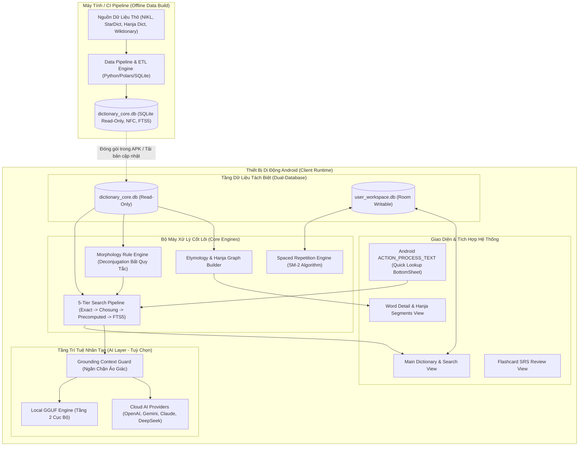
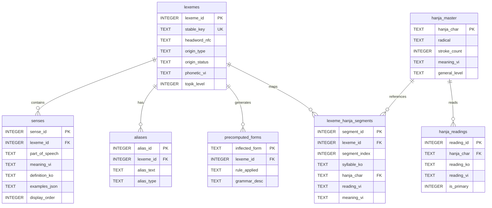
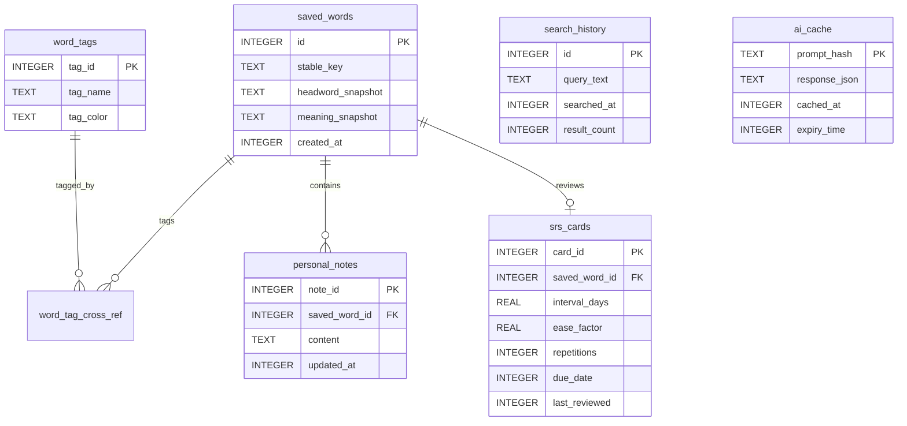
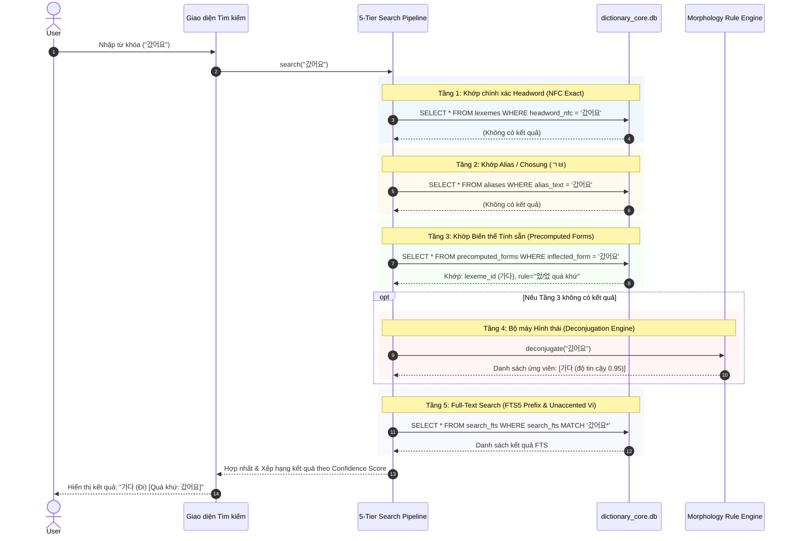

# Tài Liệu Thiết Kế Kiến Trúc Hệ Thống (ARCHITECTURE.md)

Dự án **HanViet-EtymoAI** được thiết kế dựa trên triết lý: **Offline-First, Nhẹ, Chính xác học thuật ("Không bịa nguồn gốc"), và Tách biệt ranh giới rõ ràng (Deep Modules)**.

---

## 1. Sơ đồ Tổng quan Kiến trúc Hệ thống



---

## 2. Kiến trúc Hai Cơ sở Dữ liệu Độc lập (Dual-Database Architecture)

### 2.1. `dictionary_core.db` (SQLite Chỉ Đọc - Read-Only)
File cơ sở dữ liệu này được sinh ra 100% từ quy trình ETL trên máy tính, nén chặt và đóng gói vào Assets của APK hoặc tải về theo từng phiên bản. Ứng dụng Android chỉ mở kết nối dạng `openDatabase(..., OPEN_READONLY)`.



### 2.2. `user_workspace.db` (Room Writable - Cơ sở Dữ liệu Người Dùng)
Lưu toàn bộ hành vi và dữ liệu cá nhân của người dùng. Room quản lý version và migrations độc lập hoàn toàn với dữ liệu từ điển core.



---

## 3. Quy trình Tra Cứu 5 Tầng (5-Tier Search Pipeline)

Khi người dùng nhập chuỗi tìm kiếm (ví dụ: `"gibun"`, `"ㄱㅂ"`, `"갔어요"`, `"tam trang"`):



---

## 4. Bộ Máy Giải Phân Tích Hình Thái (Morphology Rule Engine)

Xử lý triệt để 7 nhóm động từ/tính từ bất quy tắc tiếng Hàn:
1. **Bất quy tắc `ㅂ`**: `덥다` $\to$ `더워`, `춥다` $\to$ `추워`, `돕다` $\to$ `도와`.
2. **Bất quy tắc `ㄷ`**: `듣다` $\to$ `들어요`, `걷다` $\to$ `걸어요`.
3. **Bất quy tắc `ㅅ`**: `짓다` $\to$ `지어요`, `낫다` $\to$ `나아요`.
4. **Bất quy tắc `ㅎ`**: `파랗다` $\to$ `파래`, `그렇다` $\to$ `그래`.
5. **Bất quy tắc `르`**: `모르다` $\to$ `몰라요`, `빠르다` $\to$ `빨라요`.
6. **Bất quy tắc `으`**: `바쁘다` $\to$ `바빠`, `예쁘다` $\to$ `예뻐`.
7. **Bất quy tắc `ㄹ`**: `만들다` $\to$ `만듭니다` (rơi `ㄹ` trước `ㄴ, ㅂ, ㅅ`).

Engine trả về kiểu dữ liệu:
```kotlin
data class DeconjugationResult(
    val inputForm: String,
    val candidates: List<CandidateLemma>
)

data class CandidateLemma(
    val lemma: String,
    val ruleId: String,
    val ruleCategory: RuleCategory,
    val confidenceScore: Float,
    val explanationVi: String
)
```

---

## 5. Tích hợp Hệ thống Android (`ACTION_PROCESS_TEXT`)

Thay vì bắt người dùng cấp quyền nguy hiểm `SYSTEM_ALERT_WINDOW` (quyền vẽ đè màn hình mà Android ngày càng siết chặt và làm chậm máy):
- Đăng ký `IntentFilter` với action `android.intent.action.PROCESS_TEXT`.
- Khi người dùng bôi đen văn bản trong bất kỳ ứng dụng nào khác (Chrome, Zalo, PDF reader), Android tự động thêm mục: **"Tra Từ Điển Hán-Việt"** vào menu copy/paste của hệ điều hành.
- Khởi động một `QuickLookupDialog` trong suốt hoặc `BottomSheetActivity` để hiển thị ngay lập tức phân tích từ nguyên và nghĩa mà không làm gián đoạn ngữ cảnh của người dùng.
